<p align="center">
  <picture>
    <source media="(prefers-color-scheme: dark)" srcset="docs/brand/garrison-logo-large-dark.svg">
    
  </picture>
</p>

# Garrison for Stalwart

Garrison is a web console for everything around a [Stalwart](https://stalw.art)
mail server that Stalwart's own WebUI leaves to you. The WebUI manages
accounts, domains and settings. Garrison answers what an operator wants to
know on an ordinary morning: did the backup run and can it be restored, is
the sending address on a blocklist, who has been guessing passwords since
Tuesday, why has mail to one customer bounced all week, and which account is
suddenly sending fifty times its usual volume.

Every topic has its own page, and every value on it says where it came from
and when. When a check fails, Garrison sends a message to an ntfy topic, a
webhook or a mailbox.

<p align="center">
  <a href=".github/screenshots/dashboard.png">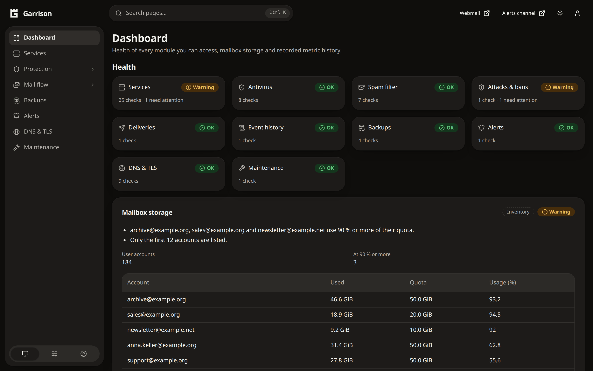</a>
</p>

Garrison runs on the mail host itself, as one static binary and four small
services without root, and users sign in with the Stalwart account they
already have. It reads what the host and Stalwart report, and it records
Stalwart's webhook events behind a privacy filter, so that deliveries, SMTP
sessions and attacks on accounts can be traced for 30 days. No message
content is stored.

Garrison shows only what it adds to Stalwart. Accounts, domains and every other
Stalwart setting stay in the official Stalwart WebUI, which Garrison neither
replaces nor modifies. Both are laid out alike on purpose: Garrison follows the
Stalwart WebUI's layout and structure, and its own colours, logo and name tell
the two apart. A user who wants it turns on a row at the bottom of the menu
that switches to the Stalwart WebUI in the same tab; an optional nginx include
adds the matching "Switch to Garrison WebUI" row there (see
[installation](docs/operator/installation.md)).

Garrison depends on Stalwart. If you run Stalwart Community, please consider
[sponsoring Stalwart Labs](https://github.com/sponsors/stalwartlabs).

Status: 0.1.1. Supported Stalwart releases:
**1.1.0**, verified by contract tests against the real server
(`cargo test --test contract`, see [contributing](CONTRIBUTING.md)).

## What it shows

| Menu | Content |
|---|---|
| Services | Process and schedule states, installed versions, newer releases of Garrison and Stalwart; pending security updates, a restart that is due, the clock, a disk forecast and the firewall service |
| Protection ▸ Antivirus, Spam filter, Attacks & bans | Scanner, signatures, the milters' verdicts by day, test messages through the mail server, an optional filter for Office macros; spam filter, classifier and rule updates, spam and ham by day and domain, how incoming senders fare with SPF, DKIM, DMARC and ARC; failed sign-ins, Stalwart's bans and TLS handshake errors by address, network and account, and accounts that send unusually much |
| Backups | Backup jobs with their last run and result, schedules, receipts and restore tests; a restic or borg repository with its newest snapshot, size, integrity check and test restore |
| DNS & TLS | Each domain's DNS records against what Stalwart names, with its MTA-STS policy and TLSA records; blocklists (IPv4 and IPv6) and reverse names of the sending addresses; the certificate of every listener that speaks TLS; how much mail travels without TLS; resolver process |
| Alerts | Notifications through ntfy, a webhook or mail when a check fails, warns or is in order again, and when the collector itself stops; monitor receipts |
| Maintenance | Start or restart configured systemd units, with confirmation and audit |
| Mail flow ▸ Deliveries, Sessions, Event history | Queue lifecycles, delays and bounces by destination and cause, messages that wait; SMTP sessions with SPF/DKIM/DMARC and rejections; recorded events |
| Dashboard | All of the above at a glance: health of every module, mailbox storage against quotas, key figures, metric history (90 days) |

Every module but the dashboard and services can be left out of an installation
(`garrison modules`).

Every value says how it was obtained (configuration, process, probe, receipt,
inventory or metric) and when. Missing data is shown as Unknown, never as zero or
success.

## Screenshots

<table>
  <tr>
    <td width="50%"><a href=".github/screenshots/dashboard-history.png">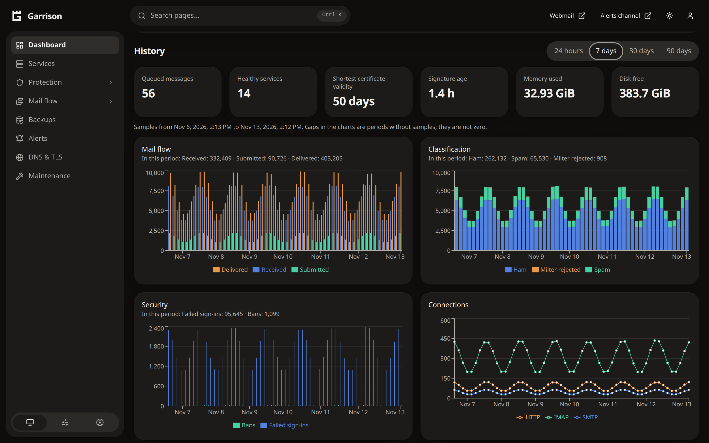</a><br>The dashboard keeps 90 days of metric history: mail flow, spam and ham, failed sign-ins, connections.</td>
    <td width="50%"><a href=".github/screenshots/attacks.png">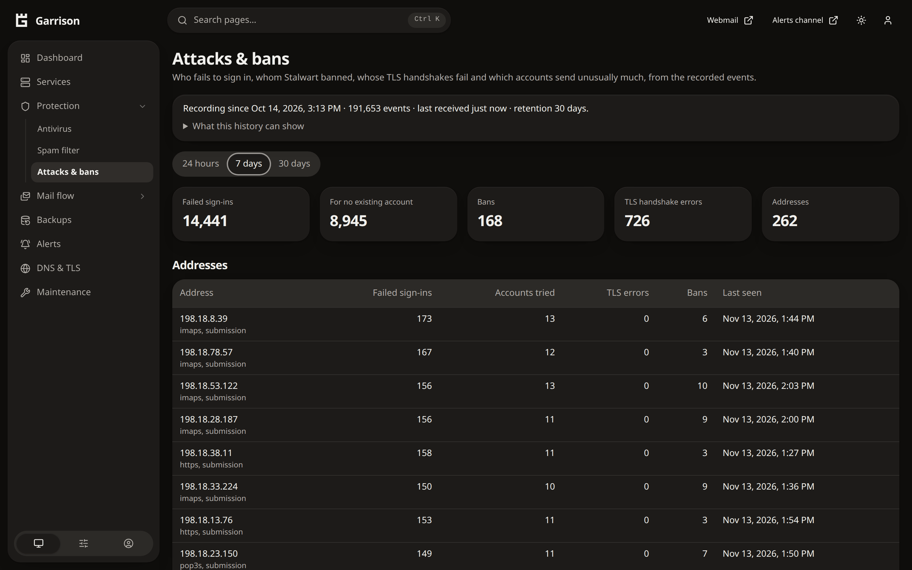</a><br>Attacks &amp; bans: failed sign-ins, Stalwart's bans and TLS handshake errors by address, network and account.</td>
  </tr>
  <tr>
    <td><a href=".github/screenshots/sending-accounts.png">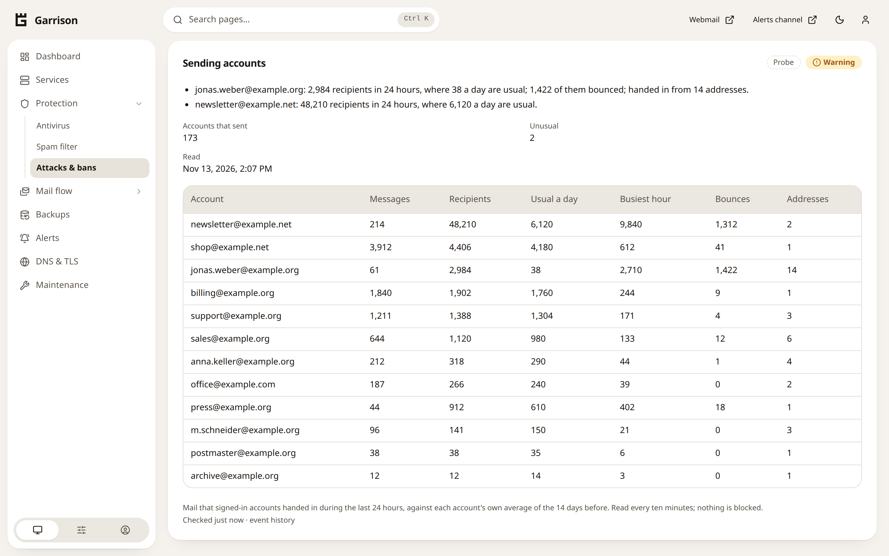</a><br>Sending accounts: each account's last day against its usual volume. A sudden jump is how a stolen password shows.</td>
    <td><a href=".github/screenshots/delivery-problems.png">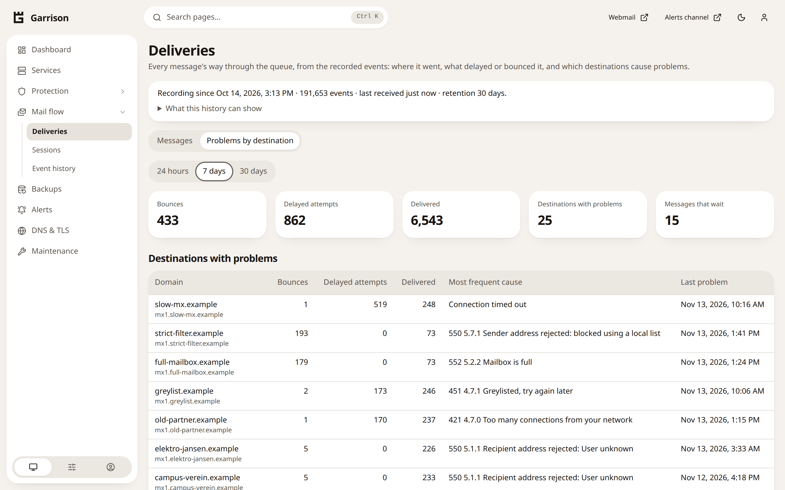</a><br>Deliveries: which destinations delay or bounce your mail, and what their servers answered.</td>
  </tr>
  <tr>
    <td><a href=".github/screenshots/spam-filter.png">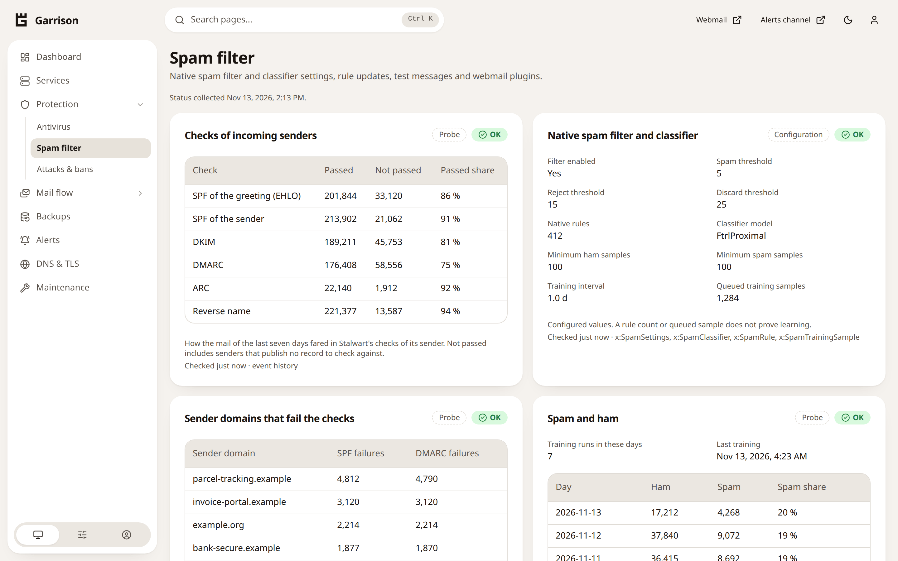</a><br>Spam filter: how incoming senders fare with SPF, DKIM, DMARC and ARC, and spam and ham by day.</td>
    <td><a href=".github/screenshots/dns-tls.png">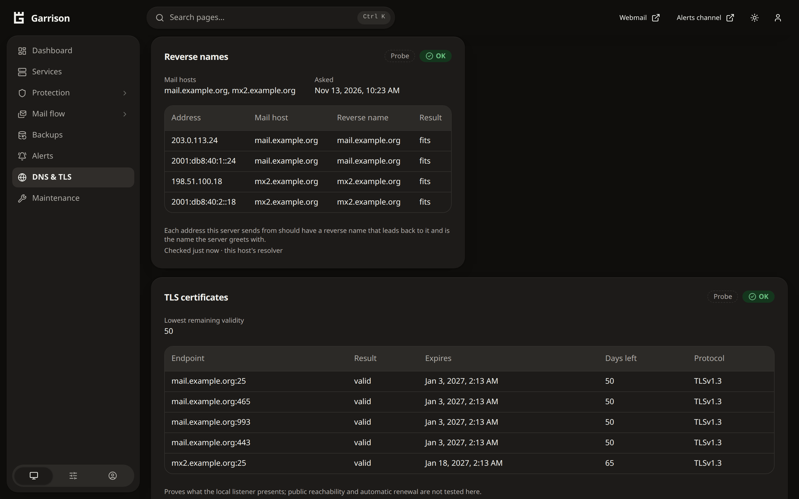</a><br>DNS &amp; TLS: the reverse names of the sending addresses and the certificate of every listener, under each mail host's name.</td>
  </tr>
  <tr>
    <td><a href=".github/screenshots/antivirus.png">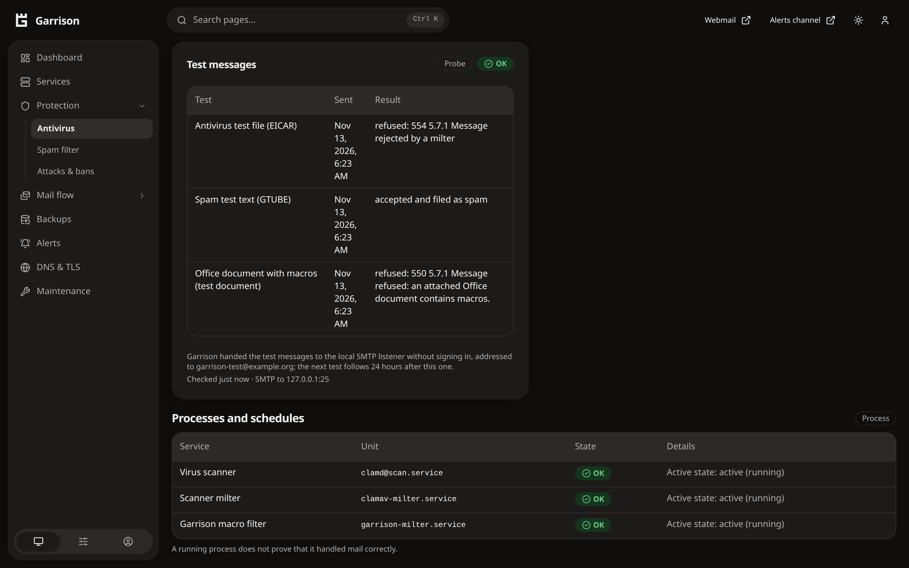</a><br>Antivirus: the daily test messages through the server, and the optional filter that refuses Office documents with macros.</td>
    <td><a href=".github/screenshots/backups.png">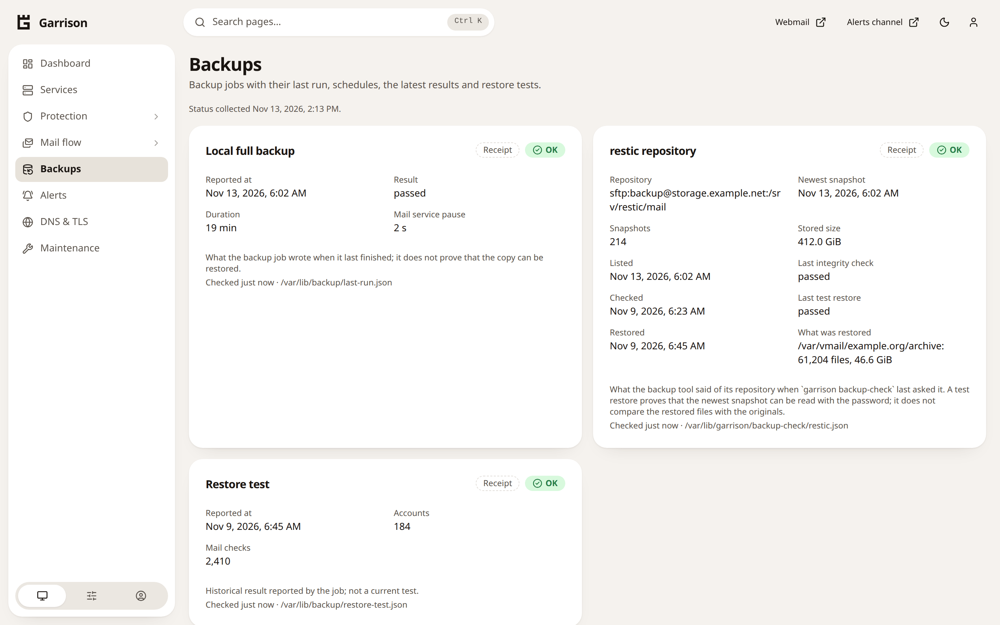</a><br>Backups: the backup job's last run, and a restic repository with its newest snapshot, integrity check and test restore.</td>
  </tr>
  <tr>
    <td><a href=".github/screenshots/services.png">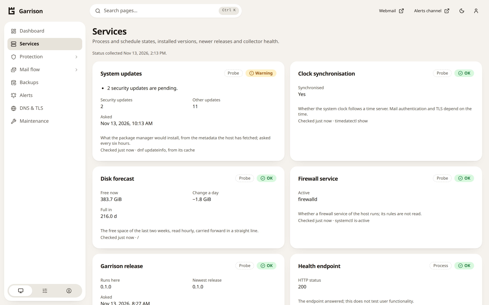</a><br>Services: pending security updates, a disk forecast, the clock and the firewall, besides units and versions.</td>
    <td><a href=".github/screenshots/sessions.png">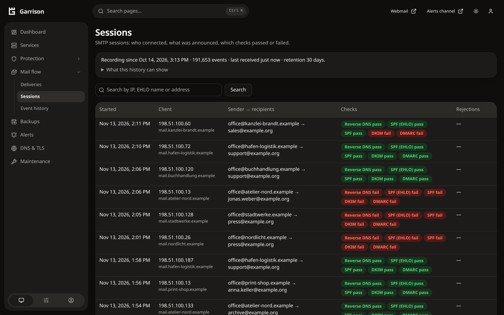</a><br>Sessions: every incoming SMTP session with the checks its sender passed or failed.</td>
  </tr>
</table>

The pictures show the preview that comes with the source, run as a busy
server (`cargo run -p garrison-web --example preview -- --busy`). All of its
data is made up: the names are reserved example names and the addresses come
from ranges reserved for documentation and benchmarking.

## How it works

```
Browser ─ nginx ─▶ web (unprivileged) ─────────── reads ─▶ status.sqlite, events.sqlite
                     │ user's openid token
                     ▼
                   broker (Unix socket, peer-checked) ─ polkit ─▶ systemctl start|restart <configured unit>
                     │ derives identity itself (UserInfo) + native roles (read-only API key)
Stalwart ─ signed webhooks ─▶ ingest (loopback) ─▶ events.sqlite
         ◀─ JMAP / Prometheus ─ collector (timer, providers) ─▶ status.sqlite
```

Four services of one static Rust binary, each under a system user of its own,
no root process. Garrison watches and reports; it changes nothing in the mail
flow. The one exception is optional and off by default: a
[macro filter](docs/operator/configuration.md#milter) that has Stalwart refuse
or mark mail with Office macros.
Details:
[architecture](docs/architecture/overview.md), [security](docs/architecture/security.md).

## Installing

Garrison needs Linux on x86_64 or aarch64 with systemd 247 and polkit 0.106
or newer, nginx or another TLS proxy, and Stalwart 1.1.0 on the same host. It
is tested on Debian, Ubuntu, AlmaLinux, Rocky Linux, CentOS Stream, Fedora,
openSUSE Leap and Amazon Linux; the
[installation guide](docs/operator/installation.md) names the releases.

```sh
tar xzf garrison-<version>-<arch>.tar.gz
sudo ./garrison-<version>-<arch>/bin/garrison install
sudo garrison setup
```

`garrison setup` asks for your host names and, once, for a Stalwart
administrator, connects the two and prints the nginx server block. The
[quick start](docs/operator/quickstart.md) has the whole way, beginning with
the signature check that belongs before the first command.

## Documentation

For operators:
[quick start](docs/operator/quickstart.md) ·
[installation](docs/operator/installation.md) ·
[configuration](docs/operator/configuration.md) ·
[checks](docs/operator/checks.md) ·
[observation ids](docs/operator/observations.md) ·
[access](docs/operator/access.md) ·
[operations](docs/operator/operations.md)

For developers: [contributing](CONTRIBUTING.md), with the engineering rules.
Security problems are reported privately, as the [security policy](SECURITY.md)
describes.

## Development quick start

```sh
cargo test --workspace --locked           # the Rust version in rust-toolchain.toml
(cd frontend && npm ci --ignore-scripts && npm test && npm run build)
eval "$(cargo xtask lab start)"           # Docker: a supported Stalwart release
cargo test --workspace --locked --test contract -- --ignored
cargo xtask lab stop
```

## Release signing key

Releases are signed with minisign. Check an archive with this key before a
first installation (see [installation](docs/operator/installation.md)):

```text
RWSKAjJdo0lsYJJA64rSgwP6KeVtTEbgqB12xkoAVxzQd+l9U0OplCP6
```

The key is compiled into every release from `deploy/signing/keys.txt`, so
`garrison upgrade` accepts only archives signed with it. Each release on the
[releases page](https://github.com/relative23/garrison/releases) comes as an
archive for x86_64 and one for aarch64, each with its signature, its checksum
and its SBOM.

## License

Project code: MIT (see [LICENSE](LICENSE)). Stalwart and all dependencies keep
their own licenses; every release archive lists them in `THIRD_PARTY_NOTICES.txt`
(`cargo xtask notices`) and in the CycloneDX SBOM `sbom.cdx.json`
(`cargo xtask sbom`). No Stalwart WebUI or Enterprise code is copied.

Stalwart is a trademark of Stalwart Labs. Garrison is an independent project and
is not affiliated with or endorsed by Stalwart Labs.
